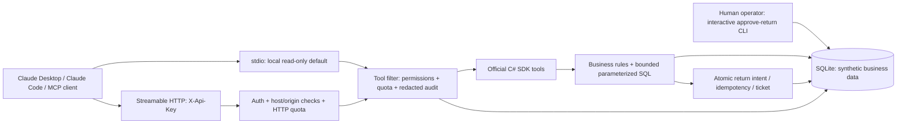

# Business Data MCP

> WIP: development stopped for a process handoff. Compilation, runtime tests,
> template execution and the Claude GIF are unverified. Private GitHub CI is gated
> until free minutes and a $0 spending stop are confirmed. This is not a verified release.

Give an AI assistant useful access to business data without handing it a SQL console
or unrestricted write permissions.

This **reference implementation** connects Claude and other MCP clients to synthetic
orders, customers and returns. It demonstrates a common client requirement: answer
support questions from an existing database, then open a return ticket only with a
separate write permission and an explicit human approval.

**C# / .NET 8 · official ModelContextProtocol SDK 2.2.0 · SQLite · stdio + Streamable HTTP · MIT**

## See it work

The real Claude capture is pending the first verified executable. See
[demo provenance and reproduction](docs/demo.md) for the prepared capture procedure.
It will use actual MCP calls over stdio and only synthetic data, with a clearly
labelled rendered conversation replay. The server itself never calls an LLM.

Try asking:

> What is the status of ORD-1001, and what other orders has this customer placed?

Expected facts from the seed: Avery Morgan; ORD-1001 is delivered ($129.90 USD);
ORD-1002 is shipped ($79.90 USD). All people and transactions are fictional.

## Architecture



The same tool registration and security filters run in both transports and in the
in-memory integration tests. Business invariants live outside MCP, in `BusinessData.Core`.

## Run in one command

Install the [.NET 8 SDK](https://dotnet.microsoft.com/download/dotnet/8.0) (8.0.426 or
later 8.0.4xx patch), Python 3 for verification, and Git. No Docker,
PostgreSQL, cloud account, LLM key or subscription is needed to run or test the server.

```bash
git clone https://github.com/IgorFedchenko/business-data-mcp.git
cd business-data-mcp
./scripts/run.sh --transport stdio
```

First launch builds the solution, creates `.data/business.db` and seeds four orders.
The process then waits for MCP JSON-RPC on stdin; stdout is reserved for protocol
messages. Diagnostic logs go to stderr. After changing source, run
`./scripts/build.sh` to refresh the executable before launching again.

On Studio, build/test scripts use the host's `studio-heavy-run` queue automatically.
On other machines they run directly. All credentials, databases and runtime artifacts
are ignored by Git. Treat `.env` as a trusted shell configuration file.

For a deterministic protocol demonstration that needs no LLM:

```bash
./scripts/build.sh
python3 scripts/protocol-demo.py
```

This starts the actual server, discovers its four read-only tools, reads an order,
and verifies that a direct call to a write tool is denied.

## Connect Claude

Build first. In [Claude Desktop's configuration](examples/claude-desktop.json), replace
`/ABSOLUTE/PATH` and use an absolute path to `dotnet` if it is not on the desktop
application's PATH. Restart Claude Desktop after editing its configuration.

For Claude Code, adapt [the stdio config](examples/claude-code-stdio.json), then:

```bash
claude --strict-mcp-config examples/claude-code-stdio.json
```

The configurations explicitly disable writes and use separate local synthetic databases.
No Claude installation or model API key is required by the test suite. A real Claude
demo uses your separately authenticated Claude client and its existing entitlement.

## Authenticated HTTP

```bash
cp .env.example .env
# Generate two different local secrets; paste only into your ignored .env file:
openssl rand -hex 32
openssl rand -hex 32
# Set MCP_READ_API_KEY; leave MCP_ALLOW_WRITES=false initially.
./scripts/run.sh --transport http
```

The endpoint is `http://127.0.0.1:5050/mcp`; `/health` returns a small health response.
Every MCP HTTP request requires `X-Api-Key`. A key in the URL is not accepted.
See [the Claude Code HTTP config](examples/claude-code-http.json); export
`MCP_READ_API_KEY` before starting Claude so its `${MCP_READ_API_KEY}` placeholder
resolves. No secret is committed in the example.

This is deliberately **API-key authentication**, not an OAuth authorization server.
Use loopback for development. Remote deployments need HTTPS, an explicit host
allowlist and appropriate network controls; see [security decisions](docs/security.md).

## Tools and permissions

| Tool | Permission | Behavior |
| --- | --- | --- |
| `search_orders` | `orders.read` | Search ID or customer name; up to 20 results |
| `get_order` | `orders.read` | Order, customer, integer-cent total and status |
| `get_order_status` | `orders.read` | Fulfillment status of one order |
| `get_customer_history` | `orders.read` | Customer, latest 20 orders and latest 20 returns |
| `prepare_return` | `returns.write` | Create an expiring, actor-bound intent |
| `request_return` | `returns.write` + human approval | Open one synthetic full-order return ticket |

Read-only clients discover only the four read tools. The call filter still checks
permissions when a client invokes a hidden tool by name. MCP tool annotations help
clients explain risk; they are not the enforcement mechanism.

To enable writes, set `MCP_ALLOW_WRITES=true`; HTTP additionally requires a distinct
`MCP_WRITE_API_KEY`. Connect the writer with this separate key. For a manual demo:

1. Ask the writer client to call `prepare_return` with `orderId="ORD-1001"`,
   `reason="damaged"`, and a unique `idempotencyKey` such as `prepare-demo-0001`.
2. In a separate **human-operated** terminal using the same `MCP_DATABASE`, run:

   ```bash
   ./scripts/run.sh approve-return RI-<the-returned-id>
   ```

   Review the displayed order, amount, reason, actor and expiry. Type the exact intent
   ID to approve it. Approval expires ten minutes after preparation. No piped approval
   or automatic `--yes` option exists.
3. Ask the original writer to call `request_return` with that `intentId` and a new
   submission key such as `submit-demo-0001`. Keep this key unchanged on retries.

Calling step 3 before approval returns `confirmation_required`; using a different
principal returns `forbidden`. The tool cannot grant approval. A retry with the same
key returns the same ticket, including after restart. A different payload under the
same key is rejected. No payment is issued in this reference implementation.

## Reliability and audit

- Immutable intents, approval expiry, actor binding and atomic consumption.
- Durable per-principal idempotency; unique constraints prevent double returns.
- Parameterized SQL, bounded queries, enumerated reasons and schema validation.
- HTTP and tool quotas, explicit errors and safe retry instructions.
- Durable audit start/completion records for calls, rejections and operator approval.
  Search terms, retry keys, arbitrary arguments and secrets are not copied to audit.
- No LLM, cloud or third-party network calls in business code or tests.

Inspect redacted local audit records:

```bash
./scripts/run.sh audit
```

Read [the security and failure model](docs/security.md) for crash consistency,
logging boundaries, trust assumptions and production hardening.

## Verify

```bash
./scripts/verify.sh
./scripts/template-smoke.sh
```

Verification runs unit tests, concurrent idempotency tests, actual MCP clients and
servers connected by in-memory pipes, HTTP tests through ASP.NET's in-memory test
server, and a real stdio subprocess smoke test. All fixtures use temporary SQLite
databases. No real secrets, paid services or model calls are required.

GitHub Actions uses the same locked dependencies and verification commands. Private
CI must stay within the owner's included minutes and a zero-spend budget. No cache
or build artifact uploads are necessary. See the Actions tab for commit-specific results.

## Start your own server

The repository doubles as a `dotnet new` template:

```bash
dotnet new install .
dotnet new business-mcp --name AcmeMcp --output ../AcmeMcp
cd ../AcmeMcp
./scripts/run.sh --transport stdio
```

The template renames the solution, assemblies and namespaces, and includes working
business tools, security filters, tests and scripts. Replace the synthetic domain and
seed with your own application boundaries; keep confirmation outside the model's tools.
To uninstall the local template, use `dotnet new uninstall <absolute-repository-path>`.
The template smoke check uses an isolated template hive and leaves your user templates alone.

## Repository layout

```text
src/BusinessData.Core/       SQLite, queries, return state machine, durable audit
src/BusinessData.Server/   SDK tools, transports, auth, limits, operator CLI
tests/BusinessData.Tests/    Business, in-memory MCP and HTTP integration tests
examples/                   Claude Desktop and Claude Code configurations
scripts/                    Build, run, verify, template smoke and demo capture
docs/                       Demo, security decisions and portfolio copy
.template.config/           dotnet new template definition
.github/workflows/          GitHub Actions verification
```

## Limits

SQLite and one trusted tenant, two API-key principals, process-local quotas, one return
per delivered order and a local operator are intentional scope choices. There is no
PostgreSQL adapter, Google Sheets integration, OAuth provider, payment gateway,
production SLA, distributed rate limiting, tamper-evident audit or public hosted backend.
The dataset is synthetic. This repository contains no employer/client code or identities.
The demo is a repository asset, so it has no hosting cost.

Built against the [official C# SDK](https://github.com/modelcontextprotocol/csharp-sdk)
2.2.0; API patterns checked at upstream commit
`84735d35a75e817d0830eaf8cacaded959d2d104`. Dependency lockfiles are committed.

[MIT License](LICENSE) · [Portfolio copy](docs/upwork-portfolio.md)
